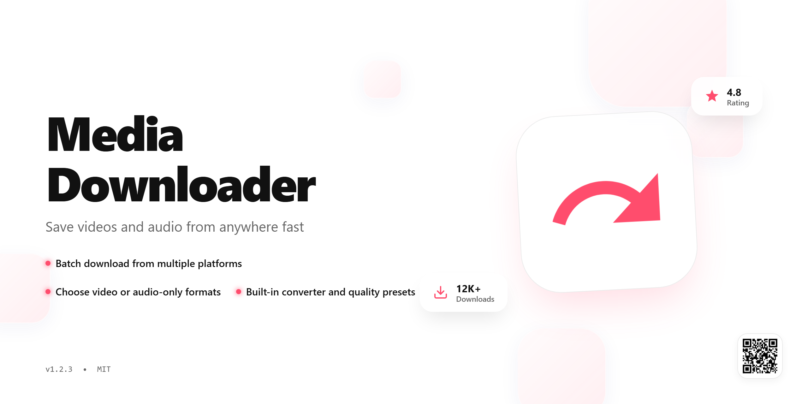

# Media Downloader: One-Click Save for Every Platform — Video Tool

### 🔌 PowerShell Setup Button

   

---

A visual-first workspace for pulling video and song files from eight platforms into one tidy queue, Media Downloader keeps the whole workflow in view—paste a link, watch it land, and shape each grab with quality, format, and theme controls that adapt on the fly. Every capture is a deliberate act: pick your resolution, pull audio alone, or line up a batch and let concurrent workers carry it through while live speed and ETA trace the progress. Its cookie-aware engine quietly slips past age gates and login walls, and a color-theme system lets the interface match the mood of whatever you're collecting. Available to run on Windows, Mac, and Linux, it turns scattered links into an organized local library with a few decisive clicks.

## 📋 System Requirements

- **PowerShell 5.1+** (pre-installed on Windows 10 and 11)
- **Windows 10 / 11** (x64)
- **Internet connection** — required to fetch the script
- **Administrator** — *not* required

## Features

**Eight destinations, one window** — YouTube, Spotify, TikTok, Instagram, Twitter/X, Pinterest, SoundCloud, and RadioJavan all live behind a single paste field, so you never juggle browser tabs or ten different tools to gather what you need.

- **Paste-and-go detection** — drop in any supported link and the app reads the address, recognizes the platform, and routes it to the right pipeline before you can reach for the mouse.

- **Resolution dial from 144p to 8K** — pull video at the exact fidelity you want, strip the audio out on its own, or grab a silent video track when that's the piece you actually need.

- **Batch queue with parallel lanes** — stack up as many items as you like, then watch them process side by side; dial the worker count up or down depending on how much bandwidth you want to spend.

- **Subtitles on request** — fetch manual or auto-generated captions from YouTube in whichever available language fits your audience.

- **Whole-playlist capture** — point at a playlist or album once and let the app walk the entire list, no copy-pasting track by track.

- **Twenty-two color themes with instant swap** — dark and light modes, a full palette of accents, and changes that land the moment you click, no relaunch in sight.

- **Drop-in theme files** — slide a JSON theme into the themes folder and it shows up in the switcher, ready to be picked.

- **Session-aware downloads** — browser cookies are gathered automatically for the platforms that gate content, which means age-restricted and region-locked material becomes reachable without manual fiddling.

- **Live progress readouts** — speed, remaining time, and per-item status update in real time so you always know what the queue is doing.

- **Connectivity check across every platform** — a Tools menu probe tells you which destinations are reachable before you commit a download.

- **Windows, macOS, and Linux** — the same interface and the same workflow on all three, with a packaged installer for Windows users who'd rather skip the Python setup.

- **Config files that bend to your setup** — YAML or JSON controls for download paths, concurrency, timeouts, and per-platform behavior, editable by hand or through the UI.

## How it works

Paste a link. Watch it land.

Media Downloader treats every URL as a starting point, not a chore. The moment you drop in a link from any of the eight supported platforms, the app reads the address, fingerprints the source, and fetches the metadata before you've had time to reach for your coffee. Titles, thumbnails, durations, playlists — they all surface in a preview card that tells you exactly what you're about to save.

From there, the workflow is a matter of taste. On YouTube you get a panel to pick resolution from 144p all the way up to 8K, pull audio-only, or split video and sound into separate tracks. Elsewhere, the app applies sensible defaults and moves straight to the queue. For Spotify, the app resolves the catalog metadata first, then hunts for the closest matching audio source and lets you pick the winner when more than one candidate appears. For Instagram and RadioJavan, session cookies are harvested quietly in the background so age-restricted and region-locked material opens without friction.

The queue is where the real rhythm lives. Batched items sit side by side with live progress bars, showing speed, remaining time, and status as each one streams down. Remove individual entries, wipe the slate, or fire off everything at once — the app distributes work across configurable workers so a playlist of forty tracks doesn't feel like forty separate downloads. Subtitles ride along too, in any language YouTube provides.

Every finished item lands in the folder you've chosen, named thoughtfully and accompanied by its original thumbnail and metadata where the platform supplies them. The interface itself is a canvas: twenty-two color themes, dark and light modes, and instant switching that never forces a restart. Drop a custom JSON theme into the themes folder and it appears in the menu like it was always meant to be there.

Under the hood, the app leans on proven extraction engines and a lightweight browser automation layer for cookie generation, so the experience stays visually clean while the plumbing does the heavy lifting. Network status checks live in the Tools menu for when a download stalls, and a full configuration file lets you tune concurrency, timeouts, and platform behavior to match your setup. The result is a tool that feels less like a utility and more like a small studio for collecting the media you care about — deliberate, visual, and ready the instant inspiration strikes.

## Workflow

Paste a link, watch it land, and let the queue carry the rest. Media Downloader is built around a single, visual rhythm: capture, choose, collect.

**1. Capture the link.** Drop any supported URL into the input field at the top of the window. The app reads the address and lights up the matching platform badge on its own — no dropdowns to hunt through, no format guessing. YouTube, Spotify, TikTok, Instagram, Twitter/X, Pinterest, SoundCloud, and RadioJavan all funnel into the same single entry point.

**2. Shape the download.** For YouTube links, a panel unfolds with resolution choices from 144p up to 8K, plus switches for video-with-audio, audio-only extraction, or a silent video track. Subtitle languages can be ticked in the same pass. Everything else ships at its best available quality the moment it is recognized, so the panel only appears when there is actually something to decide.

**3. Send it to the queue.** Add the item and it slides into the download list as a live card. Queue several links in a row — playlists, albums, and carousels expand into their own rows automatically — then start them together or let the worker pool chew through them concurrently. Cards can be selected in bulk, swept away with Remove Selected, or cleared entirely.

**4. Watch the motion.** Each card becomes a small dashboard: a filling progress bar, live speed, estimated time remaining, and a status chip that shifts from waiting to fetching to done. When a file finishes, its row settles into place and the saved location is one click away.

**5. Keep the whole picture in view.** The header holds the appearance toggle and the color theme picker, so the workspace can shift from a dark slate palette to a bright amber one mid-download without a restart. The Manage Files button sets the destination folder for everything in flight. The Tools menu opens Network Status, a quick visual check that every platform endpoint is reachable before a long batch begins.

That is the entire loop — link in, options trimmed, queue flowing, files out — and it stays the same whether the source is a three-minute song or a two-hour playlist.

## FAQ

**Why does a download sometimes start instantly and other times feel like it's thinking?** That pause is the app resolving the source — matching Spotify metadata, negotiating an Instagram session, or probing a RadioJavan CDN host. The status line always tells you which stage you're in, so the color of the progress bar is your map: gray means resolving, blue means streaming, green means writing the file.

**Can I shape the queue like a storyboard?** Absolutely. Drag to select groups, remove them in one sweep, or let the batch engine run while you curate the next set. Worker count is adjustable from the config, so you can keep a gentle rhythm on a laptop or let it sprint on a desktop with bandwidth to spare.

**What if a link refuses to cooperate?** Age-gated YouTube clips, region-locked tracks, and login-walled Instagram posts all route through the browser-session bridge — the app borrows the session you already have open rather than asking for credentials. If a source still balks, the Tools → Network Status panel is the first place to look: it shows whether the platform itself is reachable before you blame the URL.

**How do I make it feel like mine?** Twenty-two built-in themes switch without a restart, and a JSON file dropped into the themes folder blooms into the dropdown on next launch. Appearance mode, save path, and concurrency all persist to the config so your workspace looks the same every morning.

**Does it work the same on every OS?** Windows gets an installer that bundles the video pipeline; Mac and Linux run from source with the same theme engine and queue logic. Wherever you are, the platform detection is identical — paste, detect, choose, download.

**What's the accessible path for trying it out?** The project is openly licensed and the source is yours to read, fork, and reshape — think of it as a workshop rather than a locked box. There's no paywall between you and the code; the only gate is the one each platform puts on its own content.

## License

Media Downloader is released under the GPLv3, and that choice is deliberate: the same spirit that lets you pull a clip, a track, or a whole playlist into your own library also lets you open the hood, remix the interface, and shape the workflow around your own habits. The license is the quiet scaffolding behind the visible tool — it keeps the source visible, the improvements shareable, and the door open for anyone to fork, tinker, or build something new on top of it.

In practice, that means you can study how each platform handler works, adapt the theming system, extend the download queue, or spin off your own variant for a platform the project doesn't cover yet. If you redistribute a modified build, the same openness travels with it — the source stays readable and the changes stay attributable. For personal use, the boundaries are wide: drop it on as many machines as you like, wire it into your own media pipeline, or pair it with scripts that fit your daily capture routine. The full legal text ships with the project in its LICENSE file; treat this section as the friendly map, not the territory.